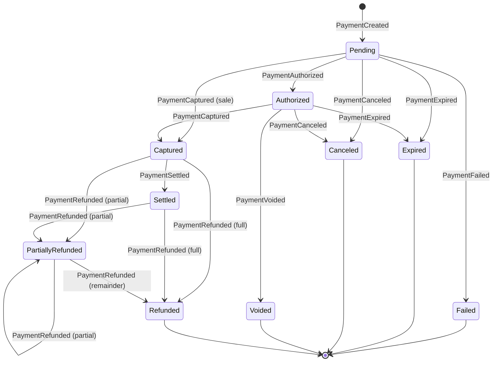

# Domain model

Deliverable 4. Status mapping and state machine below are derived from two
provider documents read while writing this, not from assumption:

- `docs.stripe.com/payments/paymentintents/lifecycle`
- `docs.midtrans.com/docs/https-notification-webhooks`

Two facts drive the design:

1. **Stripe** uses `requires_payment_method` both as the initial state and as the
   state a PaymentIntent returns to after a decline. A bare status field cannot
   distinguish "never attempted" from "attempt failed".
2. **Midtrans** only counts a payment as successful when `status_code == "200"`,
   `transaction_status` is `settlement` (or `capture` for cards), *and*
   `fraud_status == "accept"` when that field is present. Indomaret and Alfamart
   notifications omit `fraud_status`. Midtrans also documents that notifications
   can arrive out of order, and that Snap returns `404 / Payment not found` from
   GET Status until the payer selects a method.

The consequence: **our state machine is ours.** Provider statuses are inputs to a
mapping function, never the state itself. Attempt-level failure is not
Payment-level failure — that is how Stripe's reversion to
`requires_payment_method` is absorbed without violating "a payment never moves
backwards".

## Aggregates

| Aggregate root | Contains | Key invariants |
|---|---|---|
| `Payment` | `Attempt`, `Refund` entities, `PaymentInstruction` VOs | Total refunded never exceeds captured; state only moves forward; at most one active Attempt; amount and currency immutable after the first Attempt |
| `Subscription` | `Cycle` entities | A cycle produces at most one Payment; disable is terminal |
| `Journal` | `Posting` entities | Sum of debits equals sum of credits, always; immutable; corrections only by reversal |
| `Account` | — | Type and normal balance immutable |
| `WebhookEvent` | — | Unique on (provider, external_event_id); append-only |
| `AuditEntry` | — | Append-only; no update or delete path exists in code |

`Attempt` is an entity *inside* `Payment`, not its own aggregate: attempts have no
independent lifecycle. Moving them out would require a cross-aggregate invariant
on "one active attempt", which is exactly what aggregates exist to avoid.

`Refund` is also an entity *inside* `Payment`, which reverses the earlier
proposal in this document. The reason is the same one that governs `Attempt`: the
only invariant that matters is cumulative — the sum of refunds may never exceed
the captured amount — and that needs the whole set of refunds at once. As a
separate root it would have to be a cross-aggregate rule, and for money that means
eventual consistency on a rule that must never be violated, not even briefly.
Refunds are still individually addressable by `RefundId` at the port boundary, and
idempotency is enforced per (payment, key) inside the aggregate.

## Value objects

```php
final readonly class Money        { /* int minorUnits, Currency currency — ADR 0001 */ }
final readonly class Currency     { /* string code, int exponent */ }
final readonly class PaymentId    { /* ULID; never a gateway reference */ }
final readonly class IdempotencyKey { /* non-empty, bounded length */ }
final readonly class GatewayReference { /* provider string; never a primary key */ }
final readonly class GatewayAmount { /* int|string; gateway scale, not ISO scale */ }
```

### PaymentInstruction

```php
final readonly class PaymentInstruction
{
    public function __construct(
        public InstructionType $type,
        public InstructionPayload $payload,
        public ?DateTimeImmutable $expiresAt,
        public ?GatewayReference $gatewayReference,
        public bool $isStatic,
        public ?string $rawProviderType = null, // audit only
    ) {}
}
```

`InstructionType`:

```php
enum InstructionType: string
{
    case RedirectUrl       = 'redirect_url';
    case HostedPaymentLink = 'hosted_payment_link';
    case QrString          = 'qr_string';
    case QrImageUrl        = 'qr_image_url';
    case Deeplink          = 'deeplink';
    case VirtualAccount    = 'virtual_account';
    case RetailCode        = 'retail_code';
    case AuthChallenge3ds  = 'auth_challenge_3ds';
}
```

Payload variants, one class per type, each implementing `InstructionPayload`:

| Type | Payload | Fields |
|---|---|---|
| `RedirectUrl`, `HostedPaymentLink`, `Deeplink` | `LinkPayload` | `url`, `singleUse`, `platform` |
| `QrString`, `QrImageUrl` | `QrPayload` | `content` or `url`, `format` |
| `VirtualAccount` | `VirtualAccountPayload` | `bank`, `number`, `accountName` |
| `RetailCode` | `RetailCodePayload` | `store`, `code` |
| `AuthChallenge3ds` | `AuthChallengePayload` | `redirectUrl`, `challengeToken` |

Two deliberate modelling choices:

- **`isStatic` is a flag, not an enum case.** A QRIS code can be static
  (reusable, not amount-bound) or dynamic (single-use, expiring). Encoding that
  as `QR_STRING_STATIC` / `QR_STRING_DYNAMIC` would double every type in the enum.
- **`rawProviderType` is quarantined.** Midtrans sends `payment_type` values such
  as `qris`, `bank_transfer`, `echannel`, `cstore`, `akulaku`; Stripe sends
  `payment_method_types`. No business rule may read that string.

## Payment state machine

```php
enum PaymentStatus: string
{
    case Pending           = 'pending';
    case Authorized        = 'authorized';
    case Captured          = 'captured';
    case Settled           = 'settled';
    case PartiallyRefunded = 'partially_refunded';
    case Refunded          = 'refunded';
    case Voided            = 'voided';
    case Canceled          = 'canceled';
    case Expired           = 'expired';
    case Failed            = 'failed';
}
```

Transitions live in one table, so `assertCanTransition()` is a single lookup
rather than a growing `if` chain:

```php
private const ALLOWED = [
    'pending'            => ['authorized', 'captured', 'settled', 'failed', 'expired', 'canceled'],
    'authorized'         => ['captured', 'voided', 'expired', 'canceled'],
    'captured'           => ['settled', 'partially_refunded', 'refunded'],
    'settled'            => ['partially_refunded', 'refunded'],
    'partially_refunded' => ['partially_refunded', 'refunded'],
];

final class InvalidPaymentTransition extends DomainException {}
```

Terminal states: `refunded`, `voided`, `canceled`, `expired`, `failed`.
`partially_refunded` is deliberately not terminal.



Retries live on the Attempt, not here. A failed attempt inside a `Pending` payment
creates a new `Attempt`; the Payment stays `Pending`.

## Gateway status mapping

Each adapter owns a `PaymentStatusMapper` with its own unit tests built from real
payload samples.

### Stripe

| Stripe `status` | Ours |
|---|---|
| `requires_payment_method`, `requires_confirmation`, `requires_action` | `Pending` (instruction issued if action required) |
| `requires_capture` | `Authorized` |
| `processing` | `Pending`, Attempt flagged `processing` — **not** success |
| `succeeded` | `Captured` |
| `canceled` | `Canceled` |

### Midtrans

| `transaction_status` (with `fraud_status`, `status_code`) | Ours |
|---|---|
| `pending` | `Pending` |
| `authorize` | `Authorized` |
| `capture` with `fraud_status` present and not `accept` | `Authorized`, flagged for review — funds held, not confirmed |
| `capture` with `fraud_status == accept` or absent, and `status_code == "200"` | `Captured` |
| `settlement` | `Settled` |
| `deny`, `failure` | `Failed` |
| `cancel` | `Canceled` |
| `expire` | `Expired` |
| `refund` | `Refunded` |
| `partial_refund` | `PartiallyRefunded` |

The `capture` + non-`accept` `fraud_status` row is the one that matters: Midtrans
documents that as funds captured but not cleared. Mapping it straight to
`Captured` would let a merchant ship goods on a payment that may be reversed.

### Virtual-account amount mismatch

BNI and BRI VA notifications carry a `payment_amounts` array that may contain
several partial `amount` entries, so a VA payment can be under- or over-paid.
That is a reconciliation input, not a simple status flip: the amount is compared
against `gross_amount` before the state advances, and a mismatch raises
`ReconciliationMismatchDetected` rather than silently marking the payment paid.

## Domain events

Published through PSR-14 and written to the outbox in the same transaction as the
state change. Every event carries `eventId`, `occurredAt` (UTC), `paymentId`,
`merchantId`, `correlationId`.

`PaymentCreated`, `PaymentInstructionIssued`, `PaymentInstructionRefreshed`,
`PaymentInstructionExpired`, `PaymentAuthorized`, `PaymentCaptured`,
`PaymentSettled`, `PaymentFailed`, `PaymentExpired`, `PaymentCanceled`,
`PaymentVoided`, `PaymentRefunded`, `LedgerEntryPosted`,
`ReconciliationMismatchDetected`.

Payloads carry amounts and references only — never PAN, tokens, raw QR strings or
full URLs, which are bearer-like credentials. Event names are the published
language: adding a field is safe, changing one is a major version.

## Known gaps

- `Processing` is modelled as an Attempt flag, not a Payment state. Promoting it
  to a Payment state would make Stripe's `processing → requires_payment_method` a
  backward transition, which the invariant forbids.
- Over/under-paid VA payments have no dedicated state; they surface as
  `ReconciliationMismatchDetected`. Automatic partial-capture handling would be a
  design decision, not a bug fix.
- The Xendit mapper is not specified yet: its payment status enum has not been
  read from the API reference, and guessing it is not acceptable.
